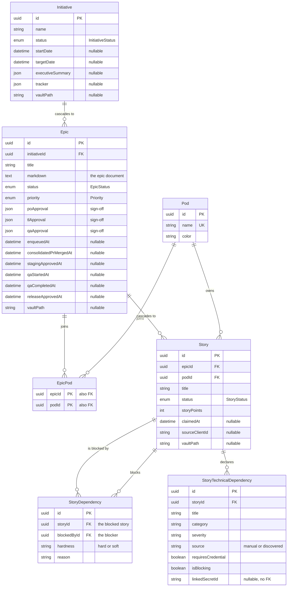
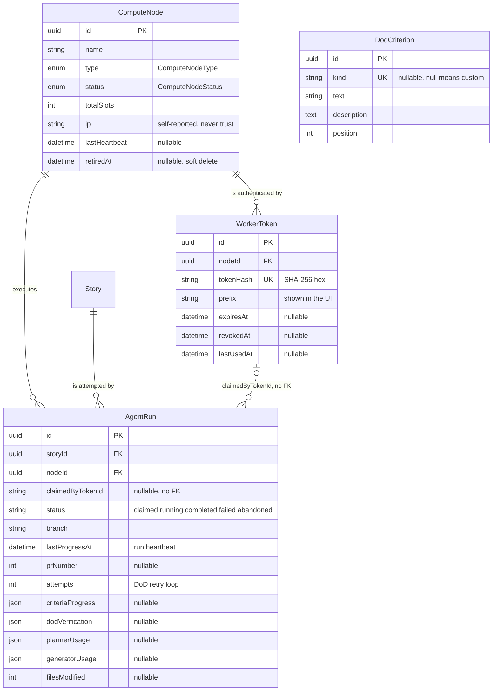
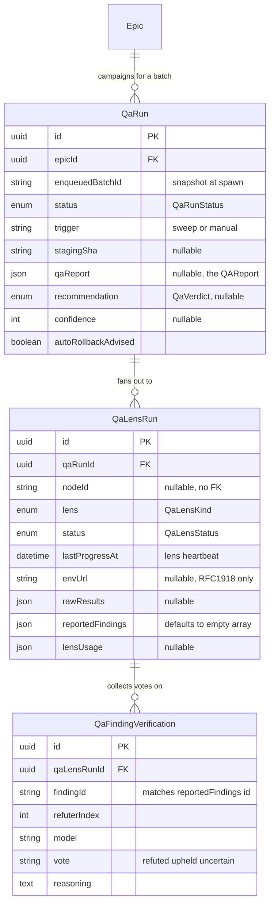

# Reference: Data model

*Reference.* What is actually stored in PostgreSQL, and why it is shaped that way.

The single source of truth is [`apps/api/prisma/schema.prisma`](../apps/api/prisma/schema.prisma):
**24 models and 12 enums** in one file, with **47 migration directories** under
`apps/api/prisma/migrations/`. This page derives from that file — when the two
disagree, the schema wins and this page is wrong.

For the vocabulary (Forge, batch, wave, Pod, gate, sign-off, vault, DAG) see
[glossary.md](glossary.md). For running migrations, seeding and the dual-Postgres
trap, see [database.md](database.md).

Every Prisma model maps to a snake_case table through `@@map`. Prose here uses the
model name (what you write Prisma queries against) and gives the table name (what you
type in `psql`) in the reference tables.

- [Planning](#planning)
- [The Forge: fleet and runs](#the-forge-fleet-and-runs)
- [The QA pipeline](#the-qa-pipeline)
- [Platform: vault, secrets and settings](#platform-vault-secrets-and-settings)
- [Design decisions that are not obvious](#design-decisions-that-are-not-obvious)
- [Migration conventions](#migration-conventions)

---

## Planning

The hierarchy is **initiative → epic → story**, with Pods attached to epics
many-to-many and owning stories one-to-many. Stories additionally form a DAG among
themselves and hang their own technical dependencies.



### Initiative → `initiatives`

Top of the hierarchy (`schema.prisma:60-87`). A name, a description, an owner, and a
`status` from the `InitiativeStatus` enum — `planning | active | completed | on_hold`
(`schema.prisma:9-14`).

- `startDate` / `targetDate` are nullable on purpose so an initiative can exist in
  draft with no dates yet (`schema.prisma:68-69`).
- `documents` is a JSON array, defaulting to `[]` (`schema.prisma:71`).
- `tracker` is a nullable JSON `TrackerReference` — optional everywhere
  (`schema.prisma:72`).
- `executiveSummary` caches the last generated summary: deterministic metrics plus AI
  narrative, overwritten on each generation (`schema.prisma:74-76`).
- `vaultPath` is nullable (`schema.prisma:79`).

Relations: `epics Epic[]`, and the child side declares `onDelete: Cascade`
(`schema.prisma:177`), so deleting an initiative deletes its epics — and, transitively,
their stories.

### Epic → `epics`

An epic is one markdown document plus the entire Forge lifecycle
(`schema.prisma:89-187`). It is the widest model in the schema and the one you will
touch most.

The content:

- `markdown` is a **Postgres column**, not a vault pointer (`schema.prisma:98`). It
  replaced twelve discrete fields in migration
  `20260428130000_collapse_epic_fields_to_markdown`, and that migration's drop was
  destructive by design (`schema.prisma:92-97`).
- `documents`, `diagrams`, `dependencies`, `designs` are JSON arrays with `[]`
  defaults; `designSkipped` is the explicit opt-out flag (`schema.prisma:104-108`).
- `poApproval`, `tlApproval`, `qaApproval` hold the three role
  [sign-offs](glossary.md#sign-off) as nullable JSON (`schema.prisma:109-111`).
- `qaMatrix` and `epicQAMatrix` are the story-level and epic-level
  [QA matrices](glossary.md#qa-matrix) (`schema.prisma:112-113`).

The Forge lifecycle, all nullable timestamps — this is where a
[batch](glossary.md#batch) lives:

| Field | Line | Set when |
|---|---|---|
| `enqueuedAt`, `enqueuedBatchId` | `:119-120` | The epic is sent to the Forge |
| `forgeBranch`, `forgeBranchCreatedAt`, `forgeBranchBaseSha` | `:126-130` | The [integration branch](glossary.md#integration-branch) is cut from DEV |
| `consolidatedPrNumber`, `consolidatedPrCreatedAt`, `consolidatedPrMergedAt` | `:132-134` | The [consolidated PR](glossary.md#consolidated-pr) is opened, then merged |
| `consolidatedMergeSha` | `:139` | Written in the same compare-and-set transaction as `consolidatedPrMergedAt` |
| `stagingApprovedAt`, `stagingApprovedBy`, `stagingApprovedByName` | `:148-150` | A Tech Lead clears the [staging gate](glossary.md#staging-gate) |
| `qaStartedAt`, `qaCompletedAt` | `:160-161` | The QA campaign starts, then its QAReport is synthesized |
| `releaseApprovedAt`, `releaseApprovedBy`, `releaseApprovedByName` | `:169-171` | The [release gate](glossary.md#release-gate) is approved |

Both approval pairs store a `…ByName` **snapshot** so the changelog stays readable
after a user is renamed (`schema.prisma:146-147`, `:167-168`).

Relations: `initiative` (cascade), `pods EpicPod[]`, `stories Story[]`, `qaRuns
QaRun[]`. One index, on `enqueuedAt` (`schema.prisma:185`) — the queue listing filters
`enqueuedAt: { not: null }` and orders by it
(`apps/api/src/modules/factory/queue/factory-queue.service.ts:456,501`).

### Pod → `pods`

A delivery team: `name` (UNIQUE, `schema.prisma:191`), `description`, `color`. Related
to epics through `EpicPod` and to stories directly.

### EpicPod → `epic_pods`

The epic↔Pod join table. No surrogate id: the primary key is the composite
`@@id([epicId, podId])` (`schema.prisma:210`), and both sides cascade
(`schema.prisma:207-208`). To attach an epic to a Pod you insert a row here; there is
no array column anywhere.

### Story → `stories`

The atomic unit the Forge executes (`schema.prisma:214-275`). `status` comes from
`StoryStatus` — `backlog | todo | in_progress | in_review | qa | done | blocked`
(`schema.prisma:30-38`).

- `epicId` cascades on delete; `podId` does **not** declare `onDelete`
  (`schema.prisma:220-223`), so it takes Prisma's default for a required relation and
  a Pod with stories cannot simply be deleted.
- `sprintId` is a bare nullable string with an index — there is no `Sprint` model in
  this schema (`schema.prisma:224`, `:271`).
- `labels` and `componentsCovered` are `String[]` with `[]` defaults
  (`schema.prisma:226`, `:235`). `componentsCovered` is what the coverage gate checks
  against the design bundle's component manifest before an epic may be enqueued
  (`schema.prisma:229-234`).
- `sourceClientId` anchors a story back to the staging proposal that produced it, so
  the Tech Lead's DAG edges — which reference client-side ids before real story ids
  exist — can be resolved (`schema.prisma:240-244`).
- `claimedAt` is the [claim](glossary.md#claim) marker: `NULL` means claimable. The
  [sweeper](glossary.md#sweeper) resets it to `NULL` when a run is abandoned
  (`schema.prisma:246-250`).
- `vaultPath` is nullable (`schema.prisma:238`). **`Story` has no markdown column** —
  see [Postgres vs the vault](#what-lives-in-postgres-and-what-lives-in-the-vault).

Indexes: `epicId`, `podId`, `sprintId`, `sourceClientId`, `claimedAt`
(`schema.prisma:269-273`).

### StoryDependency → `story_dependencies`

One edge of the [story DAG](glossary.md#story-dag) (`schema.prisma:283-299`), a
self-referencing many-to-many over `stories`.

Read the direction carefully, because it is easy to invert: `storyId` is the
**blocked** story and `blockedById` is the **blocker** (`schema.prisma:285-286`). The
two named relations are `BlockedStory` and `BlockerStory`, surfacing on `Story` as
`blockedBy` and `blocks` (`schema.prisma:257-258`, `:292-293`).

- `hardness` is a string, `'hard' | 'soft'` (`schema.prisma:287`). Only `hard` edges
  gate the claim query.
- `reason` is a string from a documented set: `api_contract`, `migration_order`,
  `shared_model`, `sequential_logic`, `other` (`schema.prisma:288`).
- `@@unique([storyId, blockedById])` prevents duplicate edges (`schema.prisma:295`).
- Both FKs cascade, so deleting a story removes its edges in either direction and
  cannot leave orphans that would break the inverse queries (`schema.prisma:281-282`).

### StoryTechnicalDependency → `story_technical_dependencies`

Per-story technical dependencies — APIs, secrets, fixtures, services, teams
(`schema.prisma:312-347`). It replaced the legacy `Epic.dependencies` JSONB plus a
vault-persisted record; epics now aggregate these read-only through their stories
(`schema.prisma:301-304`).

Everything categorical is a plain string with a documented value set, not an enum:
`category` (`secrets | apis | testing | services | teams | knowledge | other`,
`schema.prisma:319`), `severity` (`schema.prisma:320`), `source` (`manual |
discovered`, `schema.prisma:321`) and `status` (`identified | in_progress | resolved |
blocked | mitigated`, `schema.prisma:333`).

The three fields that change Forge behavior are `requiresCredential`, `isBlocking` and
`linkedSecretId` (`schema.prisma:324-326`). A dependency that requires a credential,
is blocking, and has no linked secret stops the claim before the planner spends any
tokens (`apps/api/src/modules/factory/fleet/agent-run.service.ts:1000`).

`linkedSecretId` and `targetEpicId` are plain strings with **no foreign key**
(`schema.prisma:325`, `:331`) — do not expect referential integrity there.

---

## The Forge: fleet and runs

A [compute node](glossary.md#compute-node) authenticates with a
[worker token](glossary.md#worker-token) and claims stories; each claim materializes
one [agent run](glossary.md#agent-run).



`DodCriterion` has no relation to `AgentRun` — it is a global catalog the verifier
reads, and per-run results land in `AgentRun.dodVerification`. It is drawn here
because it belongs to this area, not because a foreign key connects them.

### ComputeNode → `compute_nodes`

A registered machine running the `factory-worker` binary (`schema.prisma:699-724`).

- `type` is `ComputeNodeType` — `local | mac_mini | cloud_vm | gpu_instance | other`
  (`schema.prisma:52-58`). It is metadata for the UI only; scheduling does not read it
  (`schema.prisma:49-51`).
- `status` is `ComputeNodeStatus` — `online | offline | degraded`
  (`schema.prisma:43-47`). Derived from `lastHeartbeat` against a 90 s threshold
  (`apps/api/src/modules/factory/fleet/fleet.service.ts:24,358`).
- `ip` is **self-reported by the worker and must never be used to authenticate**; the
  bearer token is the real authentication (`schema.prisma:693-694`).
- `retiredAt` is a soft delete: retiring a node from the UI preserves its historical
  `agentRuns` and revokes its tokens instead of destroying rows
  (`schema.prisma:696-698`).

Indexes: `[status, retiredAt]` for the live-node listing, `[lastHeartbeat]` for the
cron that flips stale nodes to `offline` (`schema.prisma:718-722`).

### WorkerToken → `worker_tokens`

Bearer credential for one node (`schema.prisma:737-755`). The plaintext
`worker_<32 base32 chars>` is returned exactly once at creation, Stripe style; the
database stores only `tokenHash` (SHA-256 hex, UNIQUE, `schema.prisma:743`) and
`prefix`, the first 11 characters of the plaintext — the literal `worker_` plus
four characters of the secret (`schema.prisma:744-745`,
`worker-token.service.ts:52`).

`revokedAt` gives immediate revocation — the guard answers 401 when it is set;
`expiresAt` is optional, and null means the token does not expire; `lastUsedAt` is
refreshed on every authenticated request so anomalous use is visible in the UI
(`schema.prisma:731-736`). Deleting the node cascades to its tokens
(`schema.prisma:740`).

### AgentRun → `agent_runs`

One Claude Code run over **one story** on **one node** (`schema.prisma:772-910`).
Story-level granularity is what lets the fleet parallelize across machines while
respecting the hard edges of the DAG (`schema.prisma:757-759`).

`status` is a plain string, not an enum, with a documented lifecycle
(`schema.prisma:761-767`, `:786`):

| Status | Meaning |
|---|---|
| `claimed` | `claim-story` succeeded and the row exists; `claude` not spawned yet |
| `running` | The worker reported progress at least once |
| `completed` | Exit 0 and a pull request was created |
| `failed` | Non-zero exit; `errorMessage` says why |
| `abandoned` | The sweeper saw no progress for 10 min and reset `story.claimedAt` |

The active set (`claimed`, `running`) is exported as `AGENT_RUN_ACTIVE_STATUSES`
(`packages/shared/src/types/factory.ts:407`) and is what the per-node slot cap counts
(`apps/api/src/modules/factory/fleet/agent-run.service.ts:871-884`).

Fields worth knowing before you query:

- `lastProgressAt` is a **per-run** heartbeat, distinct from the node's
  (`schema.prisma:788-790`). The sweeper marks a run `abandoned` past
  `STALE_RUN_MS = 10 min` (`agent-run.service.ts:39`).
- `lastOutput` is trimmed stdout/stderr. The worker applies redaction regexes
  (`sk-ant-`, `ghp_`, `AKIA`, `x-access-token`) **before** sending, so secrets are not
  persisted (`schema.prisma:791-795`).
- `prNumber` being `NULL` is *not* a reliable "no PR" sentinel — it also covers runs
  from before the worker opened PRs (`schema.prisma:796-799`).
- `criteriaProgress` is a JSON timeline mixing worker milestones (workdir, clone,
  commit, push, PR) with criteria the agent self-reports through
  `/workspace/.cenzontle-criteria.json` (`schema.prisma:803-814`).
- `attempts` counts DoD retry passes, starting at 1 (`schema.prisma:823-831`);
  `dodVerification` logs the per-criterion verdict of each attempt
  (`schema.prisma:833-838`).
- Cost is split across two JSON blobs because they bill against different models:
  `plannerUsage` (`schema.prisma:848-853`) and `generatorUsage`
  (`schema.prisma:854-863`). Both are estimates from the SDK, not billing records.
- `filesModifiedPaths` is capped at 200 paths by the worker and is what the backend
  injects into the next dependent story's prompt so the agent reads existing contracts
  instead of duplicating them (`schema.prisma:872-882`).
- `claimedByTokenId` is deliberately a `String?` with **no** Prisma relation, so the
  forensic trail survives deleting the token from the catalog
  (`schema.prisma:779-784`). Indexed for leaked-token lookups (`schema.prisma:908`).

Indexes: `[storyId, status]`, `[nodeId, status]`, `[status, lastProgressAt]` (the
sweeper hot path) and `[claimedByTokenId]` (`schema.prisma:905-908`). One further
index is documented but missing — see
[the partial unique indexes](#partial-unique-indexes--and-one-that-does-not-exist).

### DodCriterion → `dod_criteria`

The global [Definition of Done](glossary.md#definition-of-done-dod) catalog
(`schema.prisma:985-1002`) — one list for every story, not per Pod or per team.

`kind` is a stable identifier that maps to deterministic evaluation (`code-written` →
`run.exitCode === 0`, `pr-created` → `run.prNumber !== null`). It is nullable **and**
UNIQUE, which Postgres allows because it permits multiple NULLs: operator-added
criteria have `kind = null` and can only be satisfied by what the agent reports in
`criteriaProgress` (`schema.prisma:978-982`, `:987-989`). `description` is required —
it is injected into the agent's prompt (`schema.prisma:991-995`). `position` persists
drag-and-drop ordering (`schema.prisma:996-997`).

Rows come from migrations, not from the seed — see
[database.md](database.md#the-seed).

---

## The QA pipeline

After the consolidated PR merges to DEV, a QA campaign fans out N
[lenses](glossary.md#qa-lens) in parallel, each reported finding is put to
[adversarial verification](glossary.md#adversarial-verification--refuter), and the
result is synthesized into a [QAReport](glossary.md#qareport) that the release gate
reads.



### QaRun → `qa_runs`

One QA campaign per batch per attempt (`schema.prisma:1066-1099`). This is genuinely
new data — unlike the Forge logs, it cannot be derived from anything else
(`schema.prisma:1056-1058`).

`QaRunStatus` (`schema.prisma:1014-1021`):

| Value | Meaning |
|---|---|
| `pending` | Created by the sweep or a manual trigger; no lens has run |
| `running` | At least one lens is executing |
| `synthesizing` | Every lens is terminal; the QAReport is being assembled |
| `completed` | QAReport persisted; the release gate is enabled |
| `failed` | Infrastructure failure — clone or serve never came up, all lenses abandoned |
| `superseded` | A manual re-run replaced this campaign |

- `enqueuedBatchId` is a **snapshot** taken at spawn, so the audit anchor stays stable
  even if the epic is enqueued again later (`schema.prisma:1070-1072`).
- `trigger` is `'sweep'` (automatic on merge to DEV) or `'manual'`; `triggeredBy` holds
  the user's `sub` for manual re-runs and is null for the cron
  (`schema.prisma:1075-1078`).
- `stagingSha` records exactly which merge commit was tested
  (`schema.prisma:1079-1080`).
- `recommendation` (`QaVerdict`: `rollout | rollback`, `schema.prisma:1051-1054`),
  `confidence` and `autoRollbackAdvised` are denormalized out of `qaReport` so listing
  and sorting do not have to parse the JSON (`schema.prisma:1085-1089`).

Indexes: `[epicId, status]` and `[status, startedAt]` (`schema.prisma:1096-1097`),
plus a partial unique index created in raw SQL — see
[below](#partial-unique-indexes--and-one-that-does-not-exist).

### QaLensRun → `qa_lens_runs`

One lens execution — the QA analogue of `AgentRun` (`schema.prisma:1111-1153`).
`QaLensKind` (`schema.prisma:1029-1034`):

| Lens | What it does |
|---|---|
| `test_suite` | Runs the repo's suite (jest/vitest) and parses pass/fail/coverage |
| `e2e` | Brings the app up through the preview service and tests the live URL |
| `security_diff` | Differential scan over the merged diff — secrets plus an AI review |
| `perf_a11y` | Latency and accessibility (axe) against the live URL |

`QaLensStatus` mirrors `AgentRun.status`: `pending | running | completed | failed |
abandoned` (`schema.prisma:1042-1048`), with the same `lastProgressAt` heartbeat and
sweeper treatment (`schema.prisma:1122-1123`).

- `nodeId` is nullable and carries **no** foreign key, exactly like
  `AgentRun.claimedByTokenId`. Today the orchestrator runs lenses in-process on the
  API host; the column exists so they can be distributed to the fleet later without a
  migration (`schema.prisma:1101-1104`, `:1116-1118`).
- `envUrl` is the [ephemeral preview](glossary.md#ephemeral-preview-environment) URL
  and is validated as an internal address before it is persisted; it stays
  null for lenses that never serve an app (`schema.prisma:1127-1130`).
- `reportedFindings` defaults to `[]` and holds
  `{ id, category, title, evidence, severity, claimedReal }` — each entry is what the
  refuters vote on (`schema.prisma:1135-1137`).

### QaFindingVerification → `qa_finding_verifications`

One row per (finding, refuter) (`schema.prisma:1159-1179`). The refuter's job is to
**disprove** the finding — flaky? environment? false positive? — and a finding counts
as real only if it survives a majority of them (`schema.prisma:1155-1158`).

`findingId` matches `reportedFindings[].id` inside the parent lens run
(`schema.prisma:1163-1164`); it is a JSON-internal id, not a foreign key. `vote` is a
string: `'refuted'`, `'upheld'`, or `'uncertain'` — an abstention that counts toward
no majority (`schema.prisma:1168-1171`). Indexed on `[qaLensRunId, findingId]`
(`schema.prisma:1177`).

---

## Platform: vault, secrets and settings

These models carry **no Prisma relations at all**. They are configuration and audit
tables, and five of them are singletons pinned to a literal primary key.

```mermaid
erDiagram
    VaultConfig {
        uuid id PK
        string name UK
        string owner
        string repo
        string branch "defaults to main"
        string tokenCiphertext "AES-256-GCM"
        boolean isActive
        json roleDefaults
        enum cloneStatus "VaultCloneStatus"
    }
    CodeRepository {
        uuid id PK
        string name UK
        string owner
        string repo
        boolean isActive "read access"
        boolean forgeWritable "write access, opt-in"
        enum cloneStatus "CodeRepoCloneStatus"
    }
    ExternalSecret {
        uuid id PK
        string name UK "env-var style"
        string vendor "nullable"
        string tokenCiphertext "AES-256-GCM"
        datetime lastRotatedAt
    }
    IntegrationConfig {
        uuid id PK
        string provider UK "linear or jira"
        string apiKeyCiphertext "AES-256-GCM"
        string apiKeyMasked "nullable, precomputed"
        json metadata "credential stripped"
        string status
    }
    ChangelogEntry {
        uuid id PK
        datetime timestamp
        string entityType "no FK"
        string entityId "no FK"
        string action
        string field "nullable"
    }
    BranchStrategyConfig {
        string id PK "literal global"
        string devBranch
        string mainBranch
        string forgeBranchPrefix
        boolean autoDeleteForgeBranch
        boolean forgePaused "kill switch"
    }
    OrgAnthropicConfig {
        string id PK "literal global"
        string apiKeyCiphertext "nullable"
        string maskedKey "nullable"
    }
    AgentTokenSettings {
        string id PK "literal singleton"
        string forgeWorkerModel
        string forgeWorkerEffort
        int forgeWorkerMaxRunDurationMs
        string dodVerifierModel
        int dodMaxAttempts
    }
    BrandingSettings {
        string id PK "literal singleton"
        string companyName
        string logoStorageKey "nullable"
    }
    DiagramThemeSettings {
        string id PK "literal singleton"
        json groupColors
        json textColors "nullable"
    }
```



### The encryption triple

Five models store a credential the same way: a `…Ciphertext` / `…Iv` / `…AuthTag`
trio, all three required to decrypt, produced by AES-256-GCM through `CryptoService`
with a key derived from `VAULT_ENCRYPTION_KEY`. Plaintext is never persisted and never
returned over HTTP.

| Model | Fields | Lines |
|---|---|---|
| `VaultConfig` | `tokenCiphertext`, `tokenIv`, `tokenAuthTag` | `schema.prisma:364-367` |
| `CodeRepository` | same triple | `schema.prisma:418-422` |
| `ExternalSecret` | same triple | `schema.prisma:466-468` |
| `IntegrationConfig` | `apiKeyCiphertext`, `apiKeyIv`, `apiKeyAuthTag` | `schema.prisma:486-488` |
| `OrgAnthropicConfig` | same, all nullable | `schema.prisma:925-928` |

Two of them keep a precomputed mask so a read does not have to decrypt just to redact:
`IntegrationConfig.apiKeyMasked` (`schema.prisma:489-491`) and
`OrgAnthropicConfig.maskedKey` (`schema.prisma:929-931`).

### VaultConfig → `vault_configs`

The GitHub repository backing the [vault](glossary.md#vault):
`owner`/`repo`/`branch`, defaulting to `main` (`schema.prisma:357-391`). Several rows
may exist but only one may be active, and that is enforced in the service layer, not
in the database (`schema.prisma:350-351`).

- `roleDefaults` is a JSON `Record<UserRole, AccessLevel>`; empty means fall back to
  the global defaults (`schema.prisma:371-374`).
- `allowedPodIds` is a `String[]` where **empty means unrestricted**, not "no access"
  (`schema.prisma:377`).
- The clone lifecycle (`cloneStatus` from `VaultCloneStatus` — `pending | cloning |
  ready | error | stale`, `schema.prisma:395-401` — plus `clonedAtPath`,
  `lastPulledAt`, `lastSyncedSha`, `lastSyncError`) supports the on-disk ripgrep search
  the agent tools use (`schema.prisma:379-385`).

### CodeRepository → `code_repositories`

Same shape, different domain — including a duplicated but deliberately separate clone
enum, `CodeRepoCloneStatus` (`schema.prisma:403-409`, `:411-449`).

The distinction that matters: `isActive` grants **read** access for the agents that
generate epics and stories, while `forgeWritable` is a separate, explicitly opt-in
flag that lets the Forge clone, commit, push and open pull requests in the repo. With
`forgeWritable = false` the repo is excluded from `getCloneUrl()` and the Forge falls
back to sandbox mode without opening PRs (`schema.prisma:427-433`).

### ExternalSecret → `external_secrets`

Third-party credentials scoped globally to the organization, named env-var style
(`STRIPE_API_KEY`) with `name` UNIQUE (`schema.prisma:460-476`). Consumed at runtime
by `ExternalSecretsService.getByName()`, never exposed over HTTP
(`schema.prisma:455-459`). `lastRotatedAt` defaults to now.

### IntegrationConfig → `integration_configs`

One row per tracker provider, `provider` UNIQUE (`'linear' | 'jira'`,
`schema.prisma:484`; model at `:482-507`). `metadata` holds the `LinearConfig` / `JiraConfig` **without**
the credential; `fieldMapping` holds the field mapping; `status` is
`connected | disconnected | error`, default `disconnected`
(`schema.prisma:493-496`).

### ChangelogEntry → `changelog_entries`

The audit trail of edits to initiatives, epics and stories
(`schema.prisma:509-525`). `entityType` and `entityId` are plain strings with **no
foreign key**, on purpose: the log must survive deletion of the row it describes.
`action` is `created | updated | deleted | approved | rejected`, and `field`,
`oldValue`, `newValue` are nullable so both field-level diffs and whole-entity events
fit the same table. Indexed on `[entityType, entityId]` and on `[timestamp]`
(`schema.prisma:522-523`).

Not the same thing as the repository's `CHANGELOG.md`.

### The singletons

Five models pin `id` to a literal default so there can only ever be one meaningful
row. Two spellings are in use, and they are not interchangeable when you write a
query:

| Model | Table | `id` default | Line |
|---|---|---|---|
| `DiagramThemeSettings` | `diagram_theme_settings` | `"singleton"` | `schema.prisma:536` |
| `AgentTokenSettings` | `agent_token_settings` | `"singleton"` | `schema.prisma:555` |
| `BrandingSettings` | `branding_settings` | `"singleton"` | `schema.prisma:666` |
| `OrgAnthropicConfig` | `org_anthropic_config` | `"global"` | `schema.prisma:924` |
| `BranchStrategyConfig` | `branch_strategy_config` | `"global"` | `schema.prisma:954` |

`AgentTokenSettings` is by far the widest of them (`schema.prisma:554-648`): a
`model` / `effort` / `maxTokens` / `thinkingEnabled` quartet for each of six AI agents
(story PO, story Tech Lead, story QA, epics, diagrams, assistant), plus the Forge
worker's own knobs — `forgeWorkerModel`, `forgeWorkerEffort`
(`schema.prisma:610-611`), `forgeWorkerMaxRunDurationMs` (default 1 800 000 ms = 30 min,
`schema.prisma:624`), `dodVerifierModel` / `dodVerifierEffort`
(`schema.prisma:632-633`) and `dodMaxAttempts` (default 1, range 1–3,
`schema.prisma:642`). Changing these is a hot config edit, not a redeploy
(`schema.prisma:545-549`, `:601-603`).

`BranchStrategyConfig` holds the three-level branch model
`main ← devBranch ← forge/sprint-batch-{epicId}` (`schema.prisma:941-950`) and the
Forge [kill switch](glossary.md#kill-switch): `forgePaused` is persisted in the
database rather than in an env var precisely so it cannot fail to propagate, and
`claim-story` returns nothing the moment it is true (`schema.prisma:959-963`).

`BrandingSettings` stores only opaque S3 storage keys; the public URLs are built at
request time in the service, so a change to frontend routing cannot break historical
rows (`schema.prisma:657-661`, `:673-677`).

---

## Design decisions that are not obvious

### A batch's stage is derived from timestamps, never stored

There is **no stage enum and no stage column**. A [batch](glossary.md#batch)'s
[stage](glossary.md#stage) is computed from the nullable timestamps on `Epic`, and the
precedence runs from most advanced to least. The canonical function is
`deriveQaStage` (`apps/api/src/modules/factory/qa/qa-stage.ts:19-25`):

```ts
export function deriveQaStage(e: StageTimestamps): QaStage | null {
  if (e.releaseApprovedAt) return 'released';
  if (e.qaCompletedAt) return 'qa-gate-ready';
  if (e.qaStartedAt) return 'qa-testing';
  if (e.consolidatedPrMergedAt) return 'staged';
  return null;
}
```

`QaStage` is `'staged' | 'qa-testing' | 'qa-gate-ready' | 'released'`
(`packages/shared/src/types/factory.ts:1164`); `null` means the batch has not merged to
DEV yet. Whether an epic is in the queue at all is a separate check —
`enqueuedAt IS NOT NULL` (`apps/api/src/modules/factory/queue/factory-queue.service.ts:456`).

Two things to know before you rely on this:

1. **The derivation is not centralized yet.** `deriveQaStage` has exactly one caller
   today, the `/factory/tests` read model
   (`apps/api/src/modules/factory/qa/qa-read.service.ts:137`). `listQueue` ships the
   raw timestamps to the client
   (`factory-queue.service.ts:639-647`) and the Pipeline Board re-derives the column
   in the browser (`apps/web/src/components/factory/FactoryOverview.tsx:990-992`,
   mapped to a `PipelineLayer` at `:1048-1053`), as does the batch detail view
   (`apps/web/src/components/factory/BatchDetail.tsx:159`).
2. **The two derivations do not use the same field for "staged".** The backend keys
   `staged` off `consolidatedPrMergedAt` (`qa-stage.ts:23`); the Pipeline Board keys
   its Staged column off `stagingApprovedAt`
   (`FactoryOverview.tsx:992`). They answer slightly different questions — "did the
   code land in DEV" versus "did a human approve it" — so read the call site before
   assuming which one a given number reflects.

One more trap: the `PipelineLayer` enum still carries a `Linear` member
(`packages/shared/src/types/factory.ts:3-10`). It is a remnant of the abandoned Linear
integration, not a live stage.

### Partial unique indexes — and one that does not exist

Prisma cannot express partial unique indexes (`CREATE UNIQUE INDEX … WHERE`) in schema
syntax, so this repo writes them as raw SQL inside migrations. Two exist, both created
by `20260613000000_add_qa_pipeline`:

```sql
-- migration.sql:49-51 — one non-terminal QA campaign per epic at a time
CREATE UNIQUE INDEX "qa_runs_epic_active_unique"
  ON "qa_runs" ("epicId")
  WHERE "status" IN ('pending', 'running', 'synthesizing');

-- migration.sql:79-81 — one active lens per (campaign, lens kind)
CREATE UNIQUE INDEX "qa_lens_runs_active_unique"
  ON "qa_lens_runs" ("qaRunId", "lens")
  WHERE "status" IN ('pending', 'running');
```

They stop the sweep cron and a manual trigger from racing each other into duplicate
campaigns for the same batch (`20260613000000_add_qa_pipeline/migration.sql:44-48`).

> **⚠️ Action required — `agent_runs_story_active_unique` is documented but no
> migration creates it.**
>
> `schema.prisma:887-904` describes a third partial unique index, presented as the
> safety net guaranteeing at most one `claimed`/`running` run per story:
>
> ```sql
> CREATE UNIQUE INDEX agent_runs_story_active_unique
>   ON agent_runs ("storyId", status)
>   WHERE status IN ('claimed', 'running');
> ```
>
> It is not in the migration history. Grepping every `.sql` under
> `apps/api/prisma/migrations/` returns nine `CREATE UNIQUE INDEX` statements, and the
> only occurrence of the name `agent_runs_story_active_unique` anywhere in that
> directory is a prose comment
> (`20260613000000_add_qa_pipeline/migration.sql:46`) citing it as precedent. What the
> schema actually declares for that table is a **non-unique** `@@index([storyId,
> status])` (`schema.prisma:905`), which enforces nothing.
>
> The `agent_runs` table itself was never created by a migration either — neither were
> `compute_nodes`, `worker_tokens`, `code_repositories`, `org_anthropic_config` or
> `branch_strategy_config`. They came from `prisma db push`, which is the same history
> gap [database.md](database.md#drift-in-the-migration-history) describes as drift. So
> whether the index exists in a given database depends entirely on whether someone ran
> that SQL by hand there.
>
> Consequences if it is absent: the `AgentRunRaceError` sentinel
> (`apps/api/src/modules/factory/fleet/agent-run.service.ts:196-211`, caught at
> `:956-964`) is raised only from a Prisma `P2002` on the `agent_runs` insert
> (`:1434-1441`). With no unique index there, `P2002` cannot happen, so the safety net
> that turns a lost race into a clean 204 and a worker retry can never fire.
> Concurrency then rests entirely on the row locks described next. Do not treat the
> comment as a guarantee: verify with `\d agent_runs` before you rely on it, and if you
> add the index, add it as a migration rather than by hand.

### `FOR UPDATE SKIP LOCKED` for story claims

`claim-story` must let N workers grab work concurrently without any two of them taking
the same story and without them queueing behind one another. The claim is one raw SQL
statement inside a transaction
(`apps/api/src/modules/factory/fleet/agent-run.service.ts:922-946`):

```sql
WITH ready_stories AS (
  SELECT s.id, s."epicId", s.title, s."podId"
  FROM stories s
  JOIN epics e ON s."epicId" = e.id
  WHERE e."enqueuedAt" IS NOT NULL
    AND s."claimedAt" IS NULL
    AND s.status NOT IN ('done', 'in_review', 'blocked')
    AND NOT EXISTS (
      SELECT 1 FROM story_dependencies dep
      JOIN stories blocker ON blocker.id = dep."blockedById"
      WHERE dep."storyId" = s.id
        AND dep.hardness = 'hard'
        AND blocker.status NOT IN ('done', 'blocked')
    )
  ORDER BY e."enqueuedAt" ASC, s."createdAt" ASC
  LIMIT 1
  FOR UPDATE OF s SKIP LOCKED
)
UPDATE stories
SET "claimedAt" = NOW()
FROM ready_stories
WHERE stories.id = ready_stories.id
RETURNING …
```

`SKIP LOCKED` is what makes it non-blocking: the first worker to lock a row wins, and
every other worker steps over that row to the next candidate instead of waiting
(`agent-run.service.ts:774-776`).

Read the `NOT EXISTS` clause carefully — a hard predecessor unblocks its dependents
when it reaches **any** terminal status, `done` **or** `blocked`. A failed story must
not strand its dependents forever: DAG *ordering* is preserved, but the failure does
not propagate (`agent-run.service.ts:905-911`).

Two more locks wrap this one:

- The transaction opens with `SELECT … FROM compute_nodes WHERE id = $1 FOR UPDATE`
  (`agent-run.service.ts:856-859`), which serializes claims from **the same node** so
  the slot cap cannot be beaten by two concurrent requests. Other nodes keep claiming
  in parallel (`agent-run.service.ts:838-848`).
- Under that lock, active runs are counted against `node.totalSlots` and the claim is
  rejected with 409 if the node is at capacity
  (`agent-run.service.ts:871-884`).

The release path is the sweeper (`agent-run.service.ts:3054-3095`): runs whose
`lastProgressAt` is older than 10 min are set to `abandoned` and their stories get
`claimedAt = NULL` so another worker can pick them up. Both `updateMany` calls re-filter
on the state they expect (`status IN (claimed, running)`, `claimedAt IS NOT NULL`) so a
worker that completed between the read and the write is not overwritten
(`agent-run.service.ts:3044-3050`).

### What lives in Postgres and what lives in the vault

The split is not "prose in the vault, structure in Postgres". It is per model:

| Content | Where it lives |
|---|---|
| Epic document (the nine level-2 headings) | **Postgres** — `Epic.markdown`, a real column (`schema.prisma:98`) |
| Story prose | **The vault only** — `Story` has no markdown column at all (`schema.prisma:214-275`) |
| Initiative / epic / story pointer into the vault | `vaultPath`, nullable on all three (`schema.prisma:79`, `:174`, `:238`) |
| Vault content itself | A GitHub repository, addressed by `VaultConfig.owner/repo/branch` (`schema.prisma:357-362`) |

Because `vaultPath` is nullable everywhere and nothing enforces it, treat "this row
has a vault document" as an open question, not an invariant — the seed, for instance,
leaves it null on every row it creates (see [database.md](database.md#the-seed)).

### Categorical strings that are not enums

Twelve enums exist, but plenty of value sets are stored as plain `String` with the
allowed values written in a comment: `AgentRun.status` (`schema.prisma:786`),
`StoryDependency.hardness` and `.reason` (`schema.prisma:287-288`),
`StoryTechnicalDependency.category` / `.severity` / `.source` / `.status`
(`schema.prisma:319-333`), `QaRun.trigger` (`schema.prisma:1076`),
`QaFindingVerification.vote` (`schema.prisma:1171`), `IntegrationConfig.provider` and
`.status` (`schema.prisma:484`, `:496`), `ChangelogEntry.entityType` and `.action`
(`schema.prisma:512-515`).

The database will happily accept any string in those columns. Validation lives in
class-validator DTOs and in the shared types, so if you write to these tables outside
the API — a script, a manual `UPDATE` — nothing catches a typo.

### Foreign keys that were left out on purpose

Four columns look like foreign keys and are not:

| Column | Why | Line |
|---|---|---|
| `AgentRun.claimedByTokenId` | Keeps the forensic trail after the token is deleted from the catalog | `schema.prisma:779-784` |
| `QaLensRun.nodeId` | Self-reported; avoids coupling the lens to `ComputeNode` before lenses are distributed | `schema.prisma:1116-1118` |
| `ChangelogEntry.entityId` | The audit log must outlive the entity it describes | `schema.prisma:512-513` |
| `StoryTechnicalDependency.linkedSecretId`, `.targetEpicId` | Soft references filled in by agents and operators | `schema.prisma:325`, `:331` |

Join through them at your own risk: the target row may be gone.

---

## Migration conventions

Directory names are `<14-digit timestamp>_<snake_case_description>`, one directory per
migration, each containing a single `migration.sql`. The description is a short English
phrase naming the change, usually verb-first — `add_story_dependencies`,
`collapse_epic_fields_to_markdown`, `replace_thinking_with_effort`,
`remove_dod_enabled_required`, and occasionally noun-first when it is a data change
(`dod_evidence_based_defaults`). Keep that style; the folder listing is how anyone
reconstructs the history.

`apps/api/prisma/migrations/migration_lock.toml` pins the provider to `postgresql` and
is committed. Do not edit it.

**Which command to run** — `migrate deploy` for applying, `migrate dev --name …` only
when you are changing `schema.prisma` — is covered in
[database.md](database.md#migrate-deploy-vs-migrate-dev--use-deploy). It is the
destructive/non-destructive distinction that matters most, so read it there rather
than trusting a summary here.

Three habits specific to this schema:

- **Hand-written SQL is allowed only for what Prisma cannot express.** Partial unique
  indexes are the live example. Add them as their own statement in the generated
  migration, with a comment explaining the predicate, as
  `20260613000000_add_qa_pipeline/migration.sql:44-51` does.
- **Data migrations belong in the migration.** Several migrations backfill instead of
  only altering — for instance `20260508250000_dod_evidence_based_defaults` inserts DoD
  criteria guarded by `WHERE NOT EXISTS` so it never clobbers what an operator edited
  (`migration.sql:29`, `:50`).
- **Expect drift, and do not "fix" it with a reset.** The repo grew with a mix of
  `db push` and migrations, so the folder is not a complete history: six tables
  (`agent_runs`, `compute_nodes`, `worker_tokens`, `code_repositories`,
  `org_anthropic_config`, `branch_strategy_config`) have no `CREATE TABLE` anywhere in
  it. `migrate status` will report the mismatch, and that does not block
  `migrate deploy` — see
  [database.md](database.md#drift-in-the-migration-history). Drift runs the other way
  too: `product_owners` and `pod_product_owners` were created by
  `20260408164458_init/migration.sql:76,96`, no migration ever dropped them, and they
  have no Prisma model today — so they may still be sitting in your database without
  being part of the data model.
